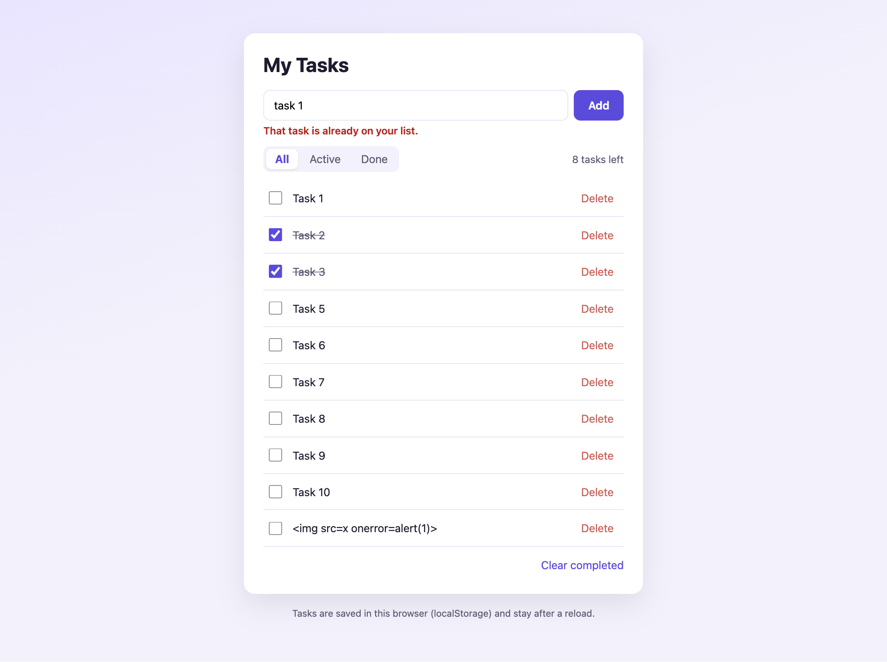
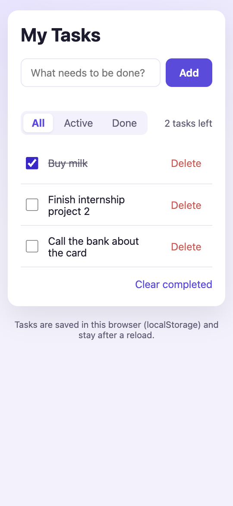

# Interactive To-Do List with LocalStorage

InternCircle internship, **Fullstack Web Development, Project 2**.
Intern: Sarim Khan

**Live:** https://sarimkhan-sketch.github.io/todo-localstorage/
**Code:** https://github.com/sarimkhan-sketch/todo-localstorage

Add, complete, filter and delete tasks. Everything is kept in `localStorage`, so tasks are still there after a reload.

 

## Features

- Add with the **Add** button or the **Enter** key; empty, spaces-only and duplicate tasks are rejected with a message
- Tick a task to complete it (line-through), **Delete** to remove it
- **All / Active / Done** filters, **"N tasks left"** counter, **Clear completed**
- Tasks persist after reload and stay in sync across open tabs
- Task text is always shown with `textContent`, never `innerHTML`

## Requirements

| Guide requirement | Where in `app.js` |
|---|---|
| DOM manipulation | `render()` rebuilds the list from the `tasks` array every time something changes |
| Event listeners (click, Enter) | form `submit` (button and Enter key); **one** delegated `click` listener on the list for every checkbox and Delete button |
| localStorage persistence | `save()` with `JSON.stringify`, `load()` with `JSON.parse` inside `try/catch` |
| State in one place | `var tasks = [{ id, text, done }]` plus `filter` |

## Checked in Chrome

Add 10 tasks, complete 2, delete 1 → counter shows "8 tasks left" and is still right after a reload.
Empty and duplicate tasks rejected. `` as a task is shown as plain text.
Corrupted storage (`{not json`) and malformed entries do not break the page. First visit (empty storage)
shows "No tasks yet". No sideways scrolling at 360px.

## Run it locally (Windows)

Download the project (green **Code** button → **Download ZIP** → right-click → *Extract All*) and
double-click `index.html`. It opens in the browser; nothing to install.

With VS Code (as in the guide): install the **Live Server** extension, *File → Open Folder…*, then
right-click `index.html` → **Open with Live Server**.

## Submission note: how I save and load data

> All tasks live in one array, `tasks`, where each task is `{ id, text, done }`. After every change
> (add, tick, delete, clear completed) the app calls `save()`, which stores the array in localStorage
> under the key `todo.tasks` with `JSON.stringify`, and then `render()` rebuilds the list from the array.
> At start-up `load()` reads the key with `JSON.parse` inside `try/catch`. If the data is missing or
> corrupted it starts with an empty list, and it drops any entry that is not a valid task, so edited or
> broken storage can never crash the page. A `storage` event listener keeps other open tabs in sync.
